# Servease: book ID-checked home service pros

**[Live demo](https://servease-demo.onrender.com)** · one-click Customer, Pro and Admin demo accounts on the sign-in screen (free hosting: the first visit can take about a minute to wake up).

Servease connects people who need help at home (aircon cleaning, plumbing, electrical work, house cleaning, tutoring and more) with **verified local pros**. Customers browse services or post a job to get quotes, then chat, book, pay and review in one place. Pros get a profile, a job board and a dashboard to run their business. Admins verify pros and keep the marketplace healthy.

It opens like an app: a splash screen, three intro slides, then Log in or Create account (as a customer or a service provider). Every page needs an account. On a phone it has a bottom tab bar (Home, Category, Bookings, Inbox, Profile), a location header, a swipeable banner and bottom-sheet filters; on a laptop it's a full website with the same Blue & Yellow look: a blue banner beside your next booking, category cards, service cards with a filter sidebar, and tables for bookings and quotes.

Built with **plain PHP 8 + MySQL/MariaDB**. There's no framework, build step or Composer, so it runs on XAMPP out of the box.

<p align="center">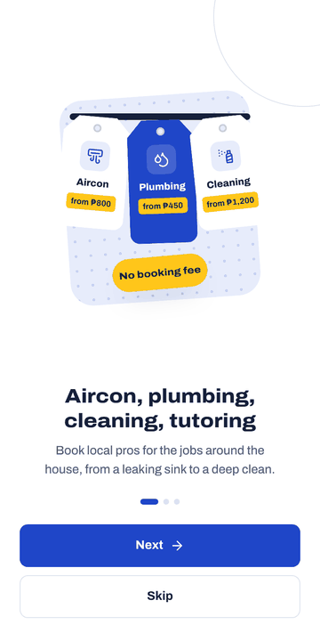</p>

| Laptop | Phone |
|---|---|
| 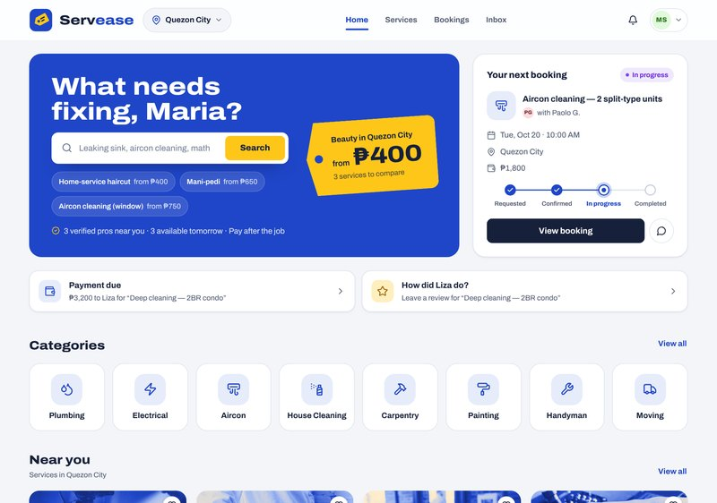 | 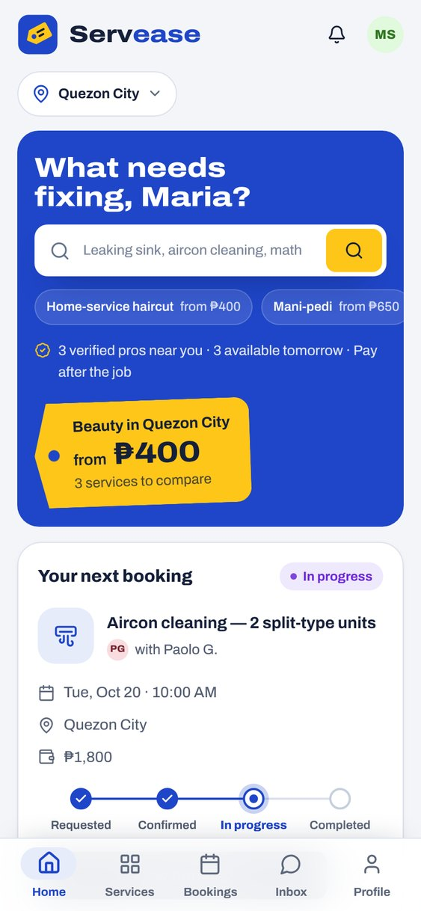 |
| 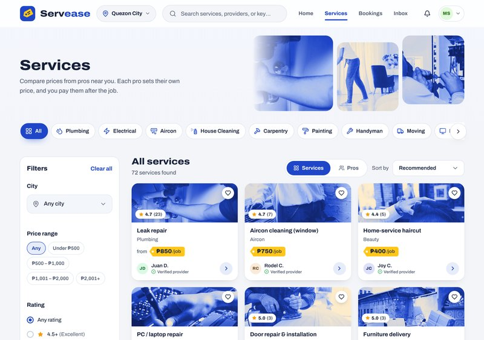 | 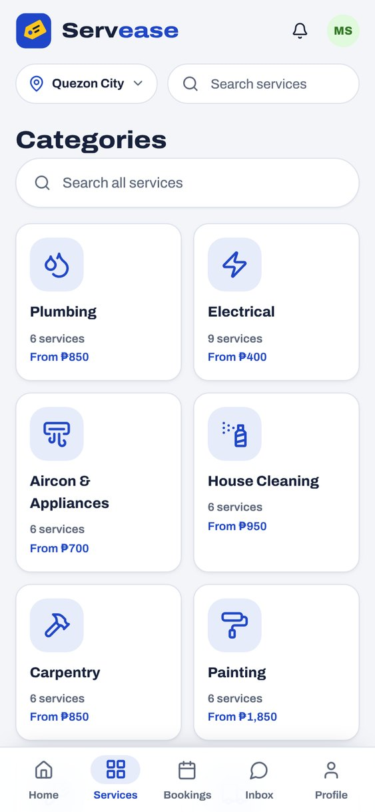 |
| 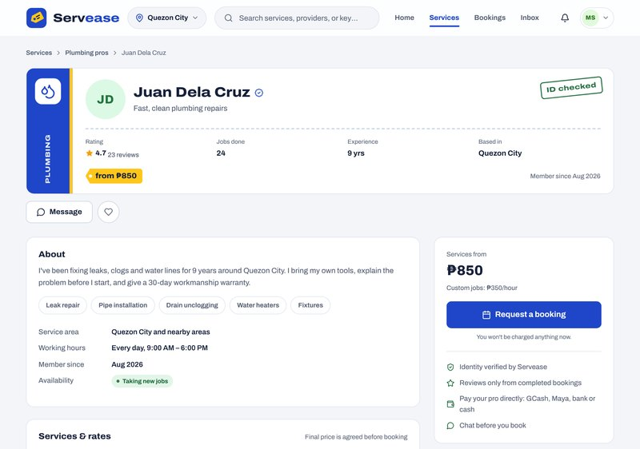 | 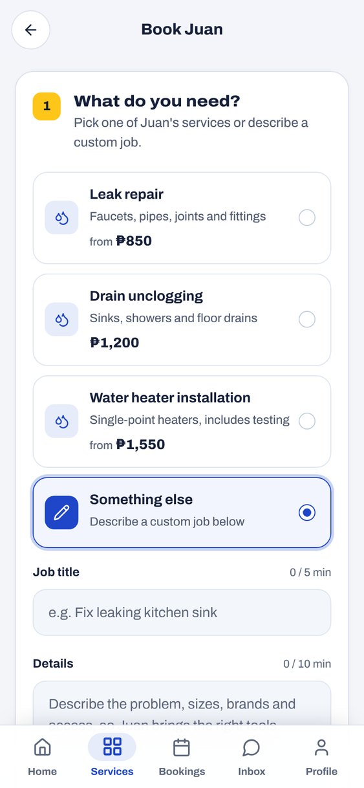 |
| 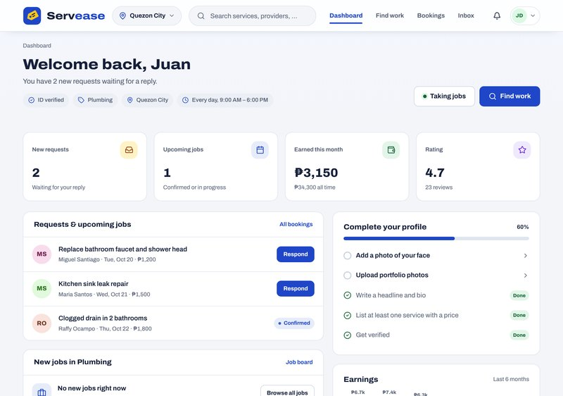 | 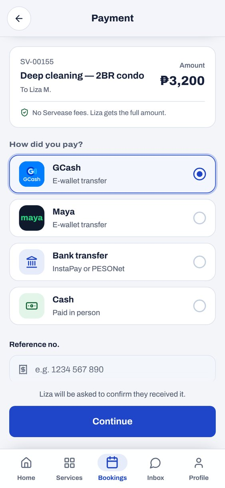 |
| 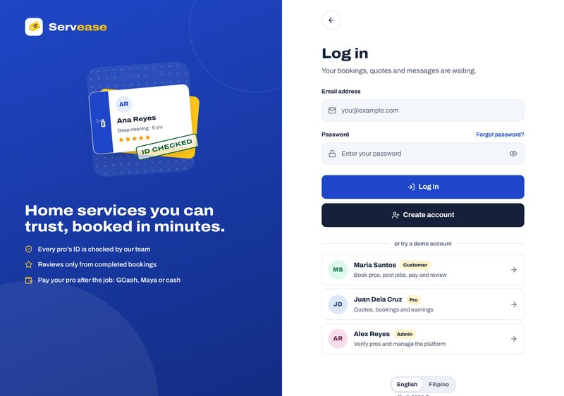 | 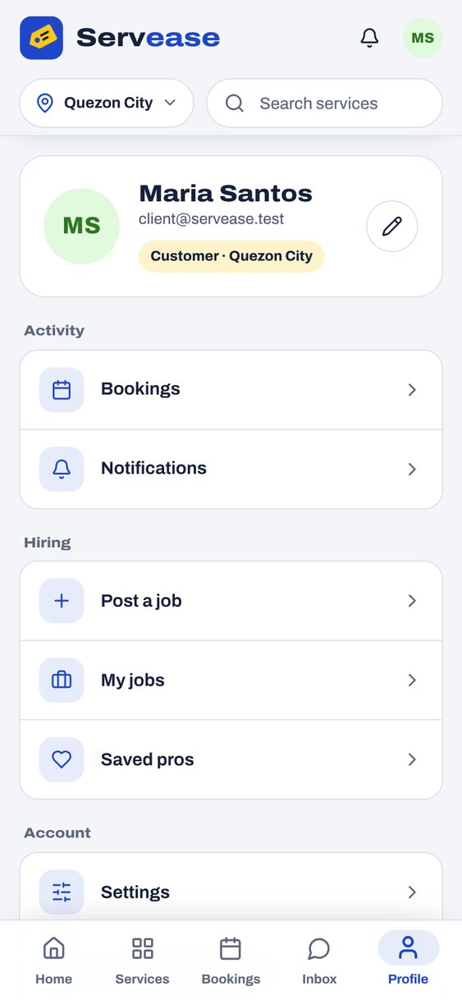 |
| 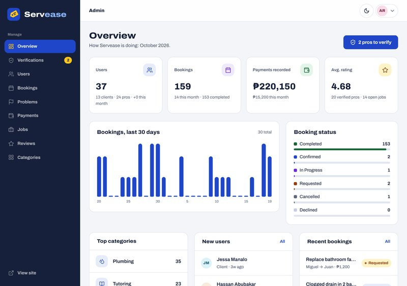 | 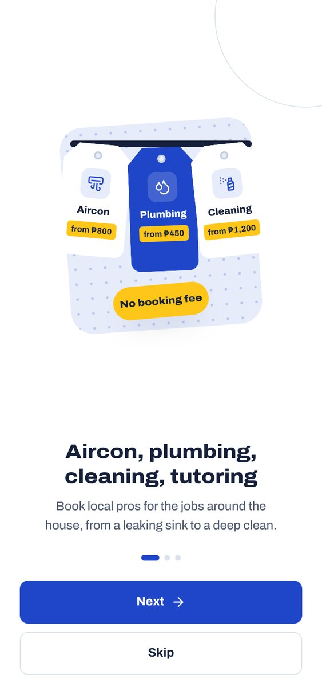 |
| 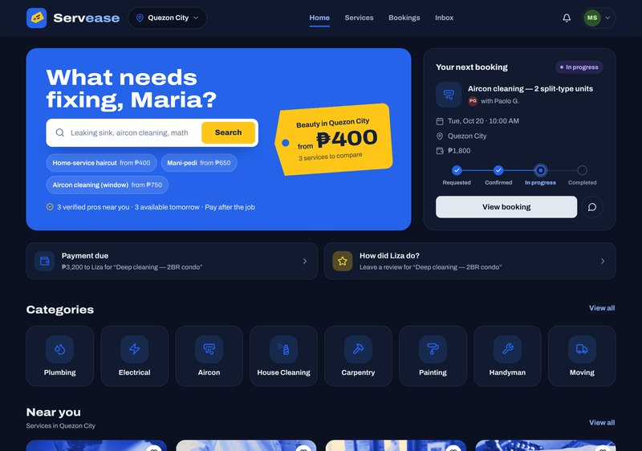 | 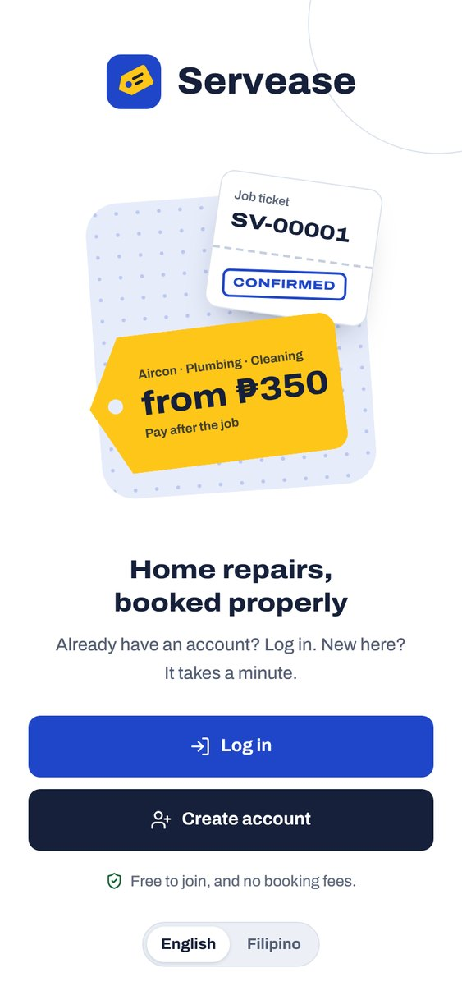 |
| 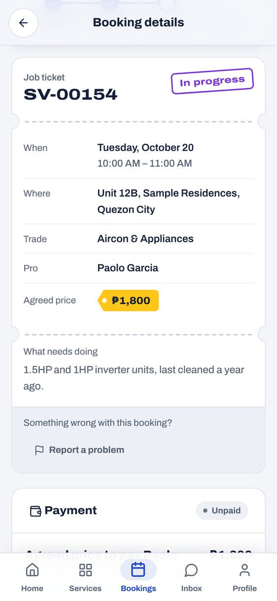 | 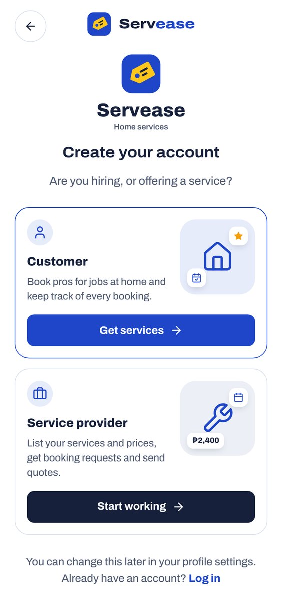 |

---

## Features

**Customers**
- Home: a swipeable banner (search first, then highlights like the most popular trade in your city), your next booking with a Requested → Confirmed → In progress → Completed tracker, reminders to pay or review finished jobs, categories, "Near you" services with price badges and top-rated pros. Customers have no separate dashboard; Home and Bookings cover it
- Category tab: every trade with its number of services and starting price
- Service-first browsing: pick a category, compare services with clear prices (fixed, starting, per hour, per day), then open the pro. Phones get a one-row-per-service list; results mix pros so no single pro fills the top. A Services/Pros switch shows the same results by pro
- Filters for city, price type, budget, pro rating, verified pros and pros taking new jobs
- Pro profiles with services and prices, portfolio, rating breakdown and reviews
- Post a job → receive quotes → accept one, pick a time the pro is free and the address → it becomes a confirmed booking
- Search suggestions as you type: matching trades, services (with how many pros and the starting price) and pros
- Or book a pro directly: the price follows the service (fixed total, hourly × hours, full day, or your estimate/budget), and the calendar only offers start times where the whole job fits the pro's hours without overlapping another booking
- Booking tracker: requested → confirmed → in progress → completed, with an activity timeline
- Reschedule: either side proposes a new day and time (only open slots), the other accepts or keeps the original
- Cancel or decline with a reason both sides can see; jobs past their day are flagged with "Did this happen?"
- Report a problem (no-show, poor work, payment, damage, safety); the Servease team replies on the booking
- Day-before reminders for both sides, in the app and by email
- Distance from your city on cards ("Pasig · ~4 km"), nearest pros first in "Near you", and a service-area map on each pro profile
- Honest payments on a dedicated payment screen: Servease doesn't hold money. Customers pay the pro directly and record it (GCash, Maya, bank transfer or cash, with the receipt's reference number for transfers) for the pro to confirm. When **PayMongo** keys are set, "Pay online" appears at the top
- Reviews that only customers with a completed booking can leave
- Chat, notifications and saved pros

**Pros**
- Profile editor: a real photo of your face (required before verification), headline, bio, skills, services and prices, portfolio photos
- Working days and hours, how long each service takes, and single days off, all of which drive the booking calendar
- ID or license verification (documents stored privately)
- Job board with quoting, request inbox, confirm/decline with price adjustment
- Jobs can only be started and completed from the day they're booked for
- Dashboard with earnings chart, profile checklist, overdue-job alerts and latest reviews (reply right there) (pros get Dashboard and Find work in the top bar instead of Home and Services)

**Admins**
- Key numbers and a 30-day bookings chart
- Verification queue (view document, approve or reject with a reason)
- Manage users, categories, bookings, jobs, payments and review moderation
- Reported problems queue: read each report and resolve it with a note both sides see

**Design**
- One design system for phone and laptop, "Blue & Yellow" in workwear shades: Archivo throughout (self-hosted, variable width), with wide, heavy headings like the lettering on a service van and normal width for reading
- The signature piece is the **job ticket**: every booking is shown as a work-order slip with its SV number, a status stamp and a perforated edge, and the bookings list uses ticket stubs with the day on the left
- Prices are yellow **price tags**, the same tag that forms the logo; the wordmark is two-tone ("Serv" in ink, "ease" in brand blue)
- A pro's profile opens with their **business card**: trade band, name and headline, rating, jobs done, years and city, a starting-price tag and an "ID checked" stamp
- Illustrations are made from the app's own objects (hang tags on a rail, a job ticket getting stamped, a business card) in HTML and CSS, so they stay sharp, follow dark mode and weigh nothing
- Trade photos share one brand duotone (navy shadows, Servease blue midtones, cream highlights) so they read as one set and the yellow price tags pop; a pro's own work photos are never filtered
- Photo cards: a pro's own work photo when they have one, otherwise a photo of the trade (assets/img/photos); every category has one. The home banner has the Servease mascot; browse pages show trade photos; line icons everywhere else
- One main action per screen, one navigation per screen size (top bar on laptops, tab bar on phones), and no empty sections shown to customers
- Phone "app mode" under 900px: bottom tab bar (Home, Services, Bookings, Inbox, Profile), location header with search and notifications, filters in a bottom sheet, a Profile tab with every account link, and full-screen chat like a messaging app
- Login-first entry: splash screen, three intro slides (Next / Skip), then Log in or Create account. Sign-up starts by choosing Customer or Service provider. Returning visitors go straight to the login screen
- Motion only where it answers you: screens slide in and out like an app, tabs cross-fade and bounce, menus and sheets open, a sent message rises in, a saved heart pops, and after you confirm or update a booking its ticket prints and the status stamp slams down. No count-ups, and everything switches off when the device asks for reduced motion
- **Sounds and haptics** (assets/js/feel.js): every sound is synthesised with the Web Audio API, so there are no audio files. Soft ticks for taps, a firmer press for main buttons, toggles, a chime for success, a low two-note for errors, a whoosh when a chat message sends, a thud when a stamp lands. Android phones also get short vibrations. One switch (Profile → Sounds, or the account menu) turns both off, remembered per device
- **English or Filipino**: a switch on the login screen, the welcome screen and Profile → Language. Pages are translated as they're sent (app/Core/Lang.php with app/lang/fil.php), so views stay in plain English
- Phone screens below a tab get an app bar (back arrow, title, and an action such as Filters) instead of the website header
- Light and dark mode, keyboard-friendly menus and dialogs, WCAG AA text contrast

## Install it as an app

Servease is a Progressive Web App: the same site opens in a browser on any device, and phones and computers can install it like a native app (home-screen icon, full screen, no browser bar, its own window on a computer).

- **Android (Chrome):** open the site. Tap **Install** on the "Get the app" card on Home, or **Profile → Install the Servease app**, or Chrome's menu → *Install app*.
- **iPhone / iPad (Safari):** tap **Install** and follow the two steps shown (Share → *Add to Home Screen*).
- **Computer (Chrome / Edge):** use **Install app** in the account menu, or the install icon in the address bar.

What makes it work:
- `/manifest.webmanifest`: name, icons (including a maskable one), colours, start page and home-screen shortcuts (Find a service, My bookings, Inbox)
- `/sw.js`: a service worker that keeps the app shell (styles, script, fonts, icons) and photos cached, so the installed app opens fast, and shows a friendly offline screen instead of the browser's error page
- Pages themselves always come from the server, so bookings, messages and payments are never stale

Installing needs **HTTPS** (or `localhost`). It works on XAMPP when you open http://localhost/Servease on the same computer. For phones, put the site on an HTTPS host (see Deploying).

## Tests

`tests/` holds six automated suites (see [tests/README.md](tests/README.md)):
- **test_flows.py**: ~110 end-to-end checks of every flow (including scheduling a quote, reschedule, cancel reasons, problem reports, suggestions and reminders) plus the permission and security rules
- **test_browser.py**: 13 real-browser checks of the interactive forms
- **test_ui.py**: real-browser checks of the phone and laptop layouts (installable app, app bar, login-first entry, tab bar, banner carousel, categories, services and pros lists, service cards, laptop header bands, filter sheet, payment screen, fonts, no sideways scrolling, dark mode)
- **test_brand.py**: checks the brand colours, including that the yellow logo and price tags stay yellow
- **test_crawl.py**: loads every page it can reach as each role and fails on any PHP error
- **test_demo.py**: public demo mode: protected demo accounts, uploads off, visitors' own accounts still working, and the daily reset

## Security

- Prepared statements everywhere (PDO, emulation off)
- CSRF tokens on every form, output escaping in every template
- `password_hash()` / `password_verify()`, session ID regeneration on login, HttpOnly + SameSite cookies
- Login throttling (5 failed attempts per 15 minutes)
- Hashed, expiring, single-use password-reset tokens and hashed email-verification tokens
- Role- and ownership-based access checks on every booking, message and payment action
- Uploads: real MIME-type check, size limits, random file names, no script execution in `/uploads`; verification IDs are stored in `storage/private` and only admins can open them
- Security headers (X-Frame-Options, nosniff, Referrer-Policy)

## Run it locally (XAMPP)

1. Put this folder at `C:\xampp\htdocs\Servease`.
2. Start **Apache** and **MySQL** in the XAMPP Control Panel.
3. Open **http://localhost/Servease/install**, keep "Load demo data" ticked and click **Install Servease**. This creates the `servease` database.
4. Log in with a demo account (password `servease123`) or use the one-click buttons on the log-in page:

| Role | Email |
|---|---|
| Customer | `client@servease.test` |
| Pro | `provider@servease.test` |
| Admin | `admin@servease.test` |

Requirements: PHP 8.0+ with `pdo_mysql`, `fileinfo` and `mbstring` (all on by default in XAMPP), MySQL 5.7+ or MariaDB 10.4+, and Apache with `mod_rewrite` (on by default in XAMPP).

Command-line alternative: `php database/install.php` (add `--no-seed` for an empty site). Quick dev server without Apache: `php -S localhost:8000 app/dev-router.php`.

### Configuration: `config/config.php`
- **Database:** host, name (`servease`), user, password
- **`app.env`:** `local` shows verification and reset links on screen (no mail server needed) and enables the installer. Set it to `production` when deploying.
- **`mail.driver`:** `log` writes emails to `storage/logs/mail.log`; `mail` uses PHP `mail()`
- **Reminders:** day-before reminders go out automatically during normal visits (at most once an hour). For exact timing, schedule `php database/reminders.php` hourly (Windows Task Scheduler: `C:\xampp\php\php.exe C:\xampp\htdocs\Servease\database\reminders.php`; Linux: cron). With `mail.driver = log` the emails land in `storage/logs/mail.log`.
- **`payments.paymongo`:** set `enabled => true` and paste your **test** secret key to turn on "Pay online" (GCash, Maya, cards, QR Ph). Payments are verified when the customer returns from checkout and also through a webhook at `/webhooks/paymongo`.

## How payments work

By default Servease **does not hold money**. The customer pays the pro directly (GCash, Maya, cash or bank transfer) and records it on the booking. The pro confirms receipt, and both sides get a clear record. This avoids the legal and payout work of running an escrow, while keeping everything traceable. Online checkout through PayMongo is built in and can be switched on in the config.

## Project structure

```
index.php              Front controller (all requests go through here)
.htaccess              URL rewriting + blocks access to internal folders
app/
  Core/                DB, Router, Auth, View, Validator, Upload, Mailer, PayMongo, Availability, Migrator, Reminders
  Controllers/         One class per area (Home, Provider, Job, Quote, Booking, Payment, Review, Message, Admin, ...)
  Views/               PHP templates (layouts, partials, pages)
    partials/          Top bar, tab bar, cards, logo and shape illustrations
  helpers.php          Escaping, URLs, CSRF, flash messages, formatting, navigation counts
  icons.php            Inline SVG icons (Lucide, ISC license)
  routes.php           All routes
assets/css/app.css     Design system (tokens, components, app shell, pages, motion, dark mode)
assets/js/app.js       Progressive enhancement (menus, filter sheet, booking slots, chat, uploads, install, transitions)
app/Views/app/          Service worker template and offline screen (served by AppController)
assets/fonts/          Archivo variable font (SIL Open Font License)
database/schema.sql    Tables, keys and indexes
database/Seeder.php    Demo data (six months of history)
database/reminders.php Day-before booking reminders (run hourly)
tests/                 Automated end-to-end, browser, layout and crawl tests
uploads/               Public user uploads (avatars, portfolio)
storage/               Private files and logs (never served)
```

### Database (main tables)
`users` · `provider_profiles` · `provider_services` · `portfolio_items` · `categories` · `jobs` · `quotes` · `bookings` · `booking_events` · `booking_issues` · `payments` · `reviews` · `conversations` · `messages` · `notifications` · `saved_providers` · `login_attempts`

## Upgrading an existing install

New columns and tables are added automatically on the first page load after an update (see `app/Core/Migrator.php`), so your data stays. Reinstalling with demo data is only needed if you want the fresh demo set.

## Deploying

Upload the folder to any PHP 8 host with MySQL. Create the database, update `config/config.php`, run the installer once, then set `'env' => 'production'` and `'debug' => false`. Use HTTPS, which also enables secure cookies automatically and lets phones install Servease as an app. Free certificates from Let's Encrypt (offered by most hosts) are enough.

**[docker/README.md](docker/README.md)** runs the public demo on Render's free plan in one container (PHP, Apache and MariaDB). **[DEPLOY.md](DEPLOY.md)** walks through putting Servease on free shared hosting (InfinityFree) as a **public portfolio demo**. Demo mode (`'public_demo' => true`) protects the demo accounts so one visitor can't lock out the next, turns uploads off, and puts the demo data back on the first visit of each day.

## Author & license

Built by **Mukramin Bariwa Ansao**. Released under the [MIT License](LICENSE). Archivo is © The Archivo Project Authors under the SIL Open Font License (`assets/fonts/ofl-archivo.txt`). The trade photos are from [Unsplash](https://unsplash.com) (Unsplash License). To use your own, replace the files in `assets/img/photos/` with the same names; they get the duotone automatically (a tinted copy is baked into `assets/img/photos/duo/` the first time it's shown). Maps © [OpenStreetMap](https://www.openstreetmap.org/copyright) contributors.
