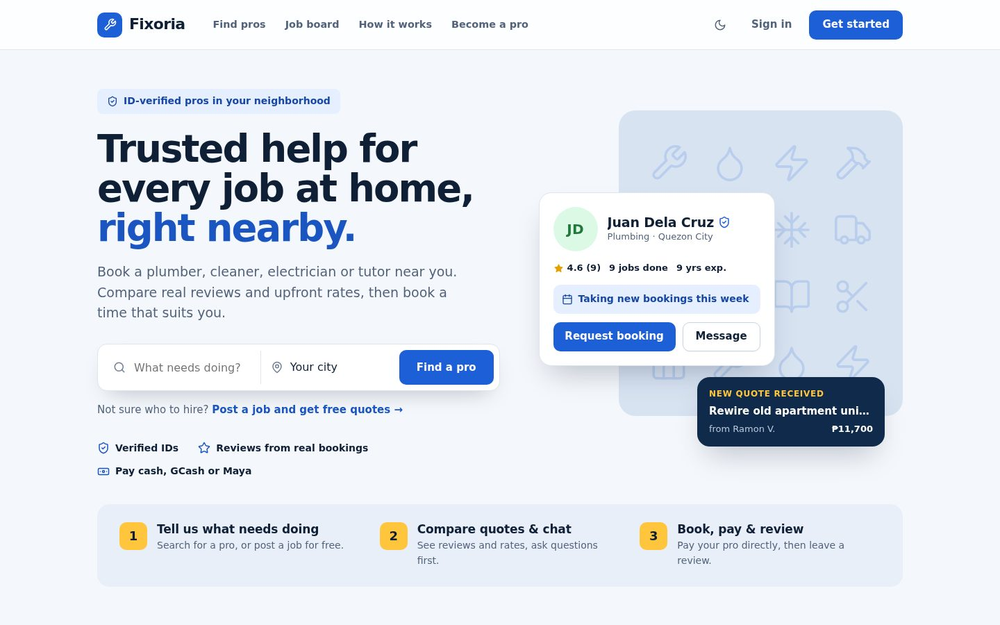
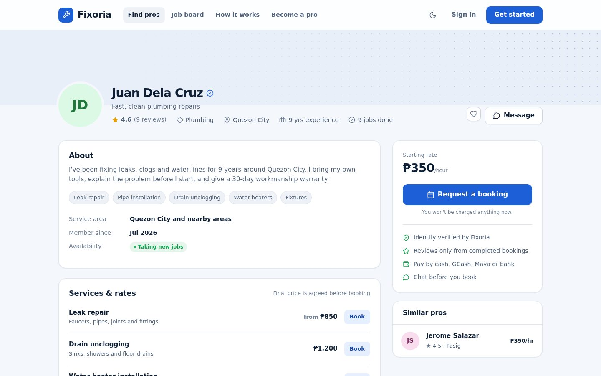
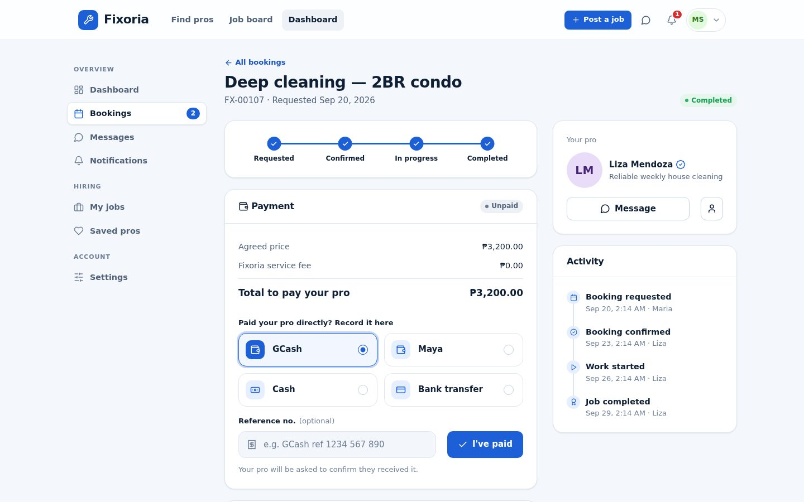
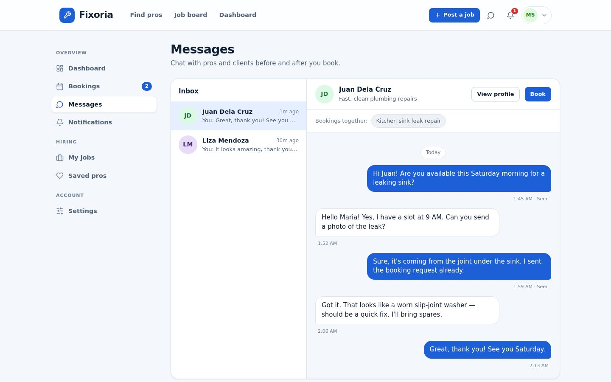
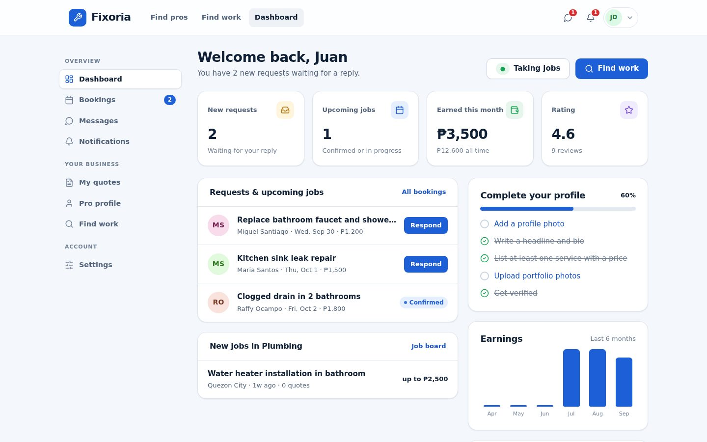
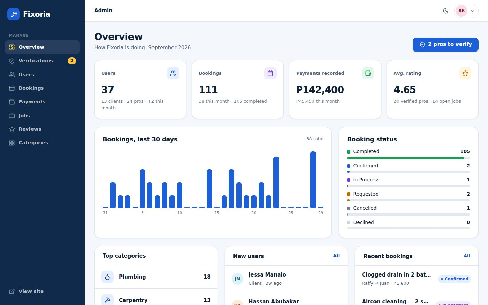
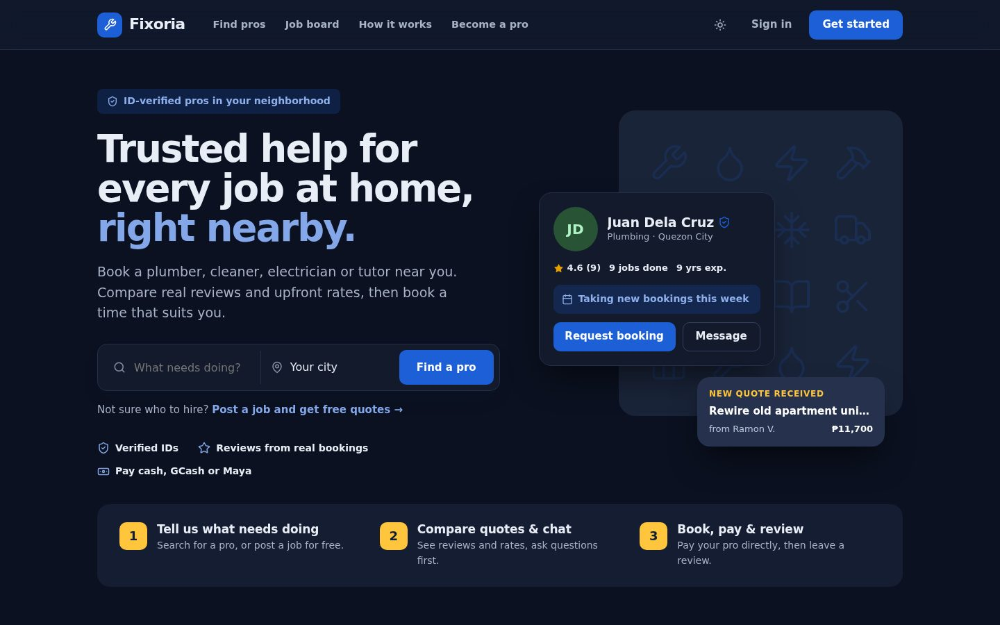
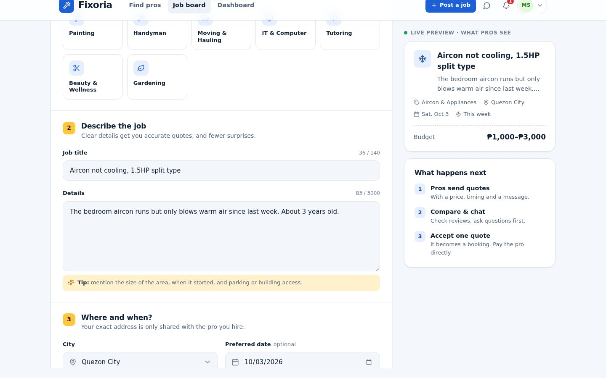
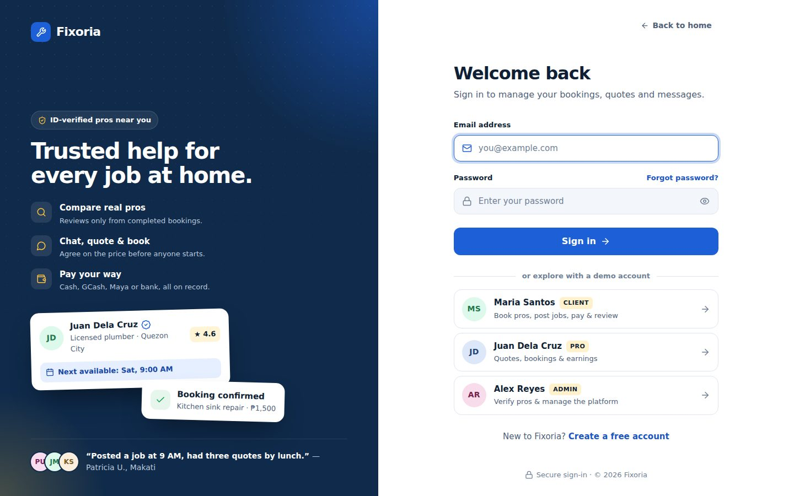

# Fixoria — local services marketplace

Fixoria connects people who need help at home (plumbing, electrical, aircon cleaning, house cleaning, tutoring and more) with **verified local pros**. Clients can browse pros or post a job to get quotes, then chat, book, pay and review, all in one place. Pros get a profile, a job board and a dashboard to run their business. Admins verify pros and keep the marketplace healthy.

Built with **plain PHP 8 + MySQL/MariaDB**. There's no framework, build step or Composer, so it runs on XAMPP out of the box.



| Provider profile | Booking flow |
|---|---|
|  |  |
| **Messages** | **Pro dashboard** |
|  |  |
| **Admin panel** | **Dark mode** |
|  |  |
| **Post a job (live preview)** | **Sign in** |
|  |  |

---

## Features

**Clients**
- Search and filter pros by service, city, rating, price, availability and verification
- Provider profiles with services and rates, portfolio, rating breakdown and reviews
- Post a job → receive quotes → accept one → it becomes a booking
- Or book a pro directly for a date and time
- Booking tracker: requested → confirmed → in progress → completed, with an activity timeline
- Record payments (cash, GCash, Maya, bank transfer) that the pro confirms, with an optional **PayMongo** online checkout
- Reviews that only clients with a completed booking can leave
- Real-time-style chat, notifications and saved pros

**Pros**
- Profile editor: headline, bio, skills, services and prices, portfolio photos
- ID or license verification (documents stored privately)
- Job board with quoting, request inbox, confirm/decline with price adjustment
- Dashboard with earnings chart, profile-completeness checklist and latest reviews
- Public replies to reviews, availability toggle

**Admins**
- KPIs and a 30-day bookings chart
- Verification queue (view document, approve or reject with reason)
- Manage users (suspend/reactivate), categories, bookings, jobs, payments, and review moderation

**Design**
- Stepped forms with a live preview (post a job, request a booking), icon tiles, quick-pick chips, date strip and time slots instead of plain dropdowns
- Filled inputs with icons, live password checklist, character counters, custom checkboxes and switches, and an "unsaved changes" bar on long forms

**Quality**
- Responsive design (mobile → desktop), dark mode, accessible markup (labels, focus states, keyboard-friendly menus and dialogs)
- Three built-in colour themes: `blue` (Trusted Blue & Yellow, default), `green` and `navy`
- Fast: one CSS file and one small JS file, no CSS framework or build step, cache-busted assets, indexed queries, paginated lists

## Tests

`tests/` holds three automated suites (see [tests/README.md](tests/README.md)):
- **test_flows.py**: 59 end-to-end checks of every flow plus the permission and security rules
- **test_browser.py**: 13 real-browser (Playwright) checks of the interactive forms
- **test_crawl.py**: loads ~550 pages as each role and fails on any PHP error

## Security

- Prepared statements everywhere (PDO, emulation off)
- CSRF tokens on every form, output escaping in every template
- `password_hash()` / `password_verify()`, session ID regeneration on login, HttpOnly + SameSite cookies
- Login throttling (5 failed attempts per 15 minutes)
- Hashed, expiring, single-use password-reset tokens and hashed email-verification tokens
- Role- and ownership-based access checks on every booking, message and payment action
- Uploads: real MIME-type check, size limits, random file names, no script execution in `/uploads`; verification IDs are stored outside the web root area (`storage/private`) and only admins can open them
- Security headers (X-Frame-Options, nosniff, Referrer-Policy)

## Run it locally (XAMPP)

1. Put this folder at `C:\xampp\htdocs\Fixoria`.
2. Start **Apache** and **MySQL** in the XAMPP Control Panel.
3. Open **http://localhost/Fixoria/install**, keep "Load demo data" ticked and click **Install Fixoria**.
4. Sign in with a demo account (password `fixoria123`) or use the one-click buttons on the sign-in page:

| Role | Email |
|---|---|
| Client | `client@fixoria.test` |
| Pro | `provider@fixoria.test` |
| Admin | `admin@fixoria.test` |

Requirements: PHP 8.0+ with `pdo_mysql`, `fileinfo` and `mbstring` (all on by default in XAMPP), MySQL 5.7+ or MariaDB 10.4+, and Apache with `mod_rewrite` (on by default in XAMPP).

Command-line alternative: `php database/install.php` (add `--no-seed` for an empty site). Quick dev server without Apache: `php -S localhost:8000 app/dev-router.php`.

### Configuration: `config/config.php`
- **Database:** host, name (`fixoria`), user, password
- **`app.env`:** `local` shows verification and reset links on screen (no mail server needed) and enables the installer. Set it to `production` when deploying.
- **`app.theme`:** `blue` (default) | `green` | `navy`
- **`mail.driver`:** `log` writes emails to `storage/logs/mail.log`; `mail` uses PHP `mail()`
- **`payments.paymongo`:** set `enabled => true` and paste your **test** secret key to turn on "Pay online" (GCash, Maya, cards, QR Ph). Payments are verified when the client returns from checkout and also through a webhook at `/webhooks/paymongo`.

## How payments work

By default Fixoria **does not hold money**. The client pays the pro directly (cash, GCash, Maya or bank transfer) and records it on the booking. The pro confirms receipt, and both sides get a clear record. This avoids the legal and payout work of running an escrow, while keeping everything traceable. Online checkout through PayMongo is built in and can be switched on in the config.

## Project structure

```
index.php              Front controller (all requests go through here)
.htaccess              URL rewriting + blocks access to internal folders
app/
  Core/                DB, Router, Auth, View, Validator, Upload, Mailer, PayMongo
  Controllers/         One class per area (Home, Provider, Job, Quote, Booking, Payment, Review, Message, Admin, ...)
  Views/               PHP templates (layouts, partials, pages)
  helpers.php          Escaping, URLs, CSRF, flash messages, formatting
  routes.php           All routes
assets/css/app.css     Design system (tokens, components, pages, dark mode)
assets/js/app.js       Progressive enhancement (menus, dialogs, chat, uploads)
database/schema.sql    Tables, keys and indexes
database/Seeder.php    Demo data
tests/                 Automated end-to-end, browser and crawl tests
uploads/               Public user uploads (avatars, portfolio)
storage/               Private files and logs (never served)
```

### Database (main tables)
`users` · `provider_profiles` · `provider_services` · `portfolio_items` · `categories` · `jobs` · `quotes` · `bookings` · `booking_events` · `payments` · `reviews` · `conversations` · `messages` · `notifications` · `saved_providers` · `login_attempts`

## Deploying

Upload the folder to any PHP 8 host with MySQL. Create the database, update `config/config.php`, run the installer once, then set `'env' => 'production'` and `'debug' => false`. Use HTTPS, which also enables secure cookies automatically.

## Author & license

Built by **Mukramin Bariwa Ansao**. Released under the [MIT License](LICENSE).
